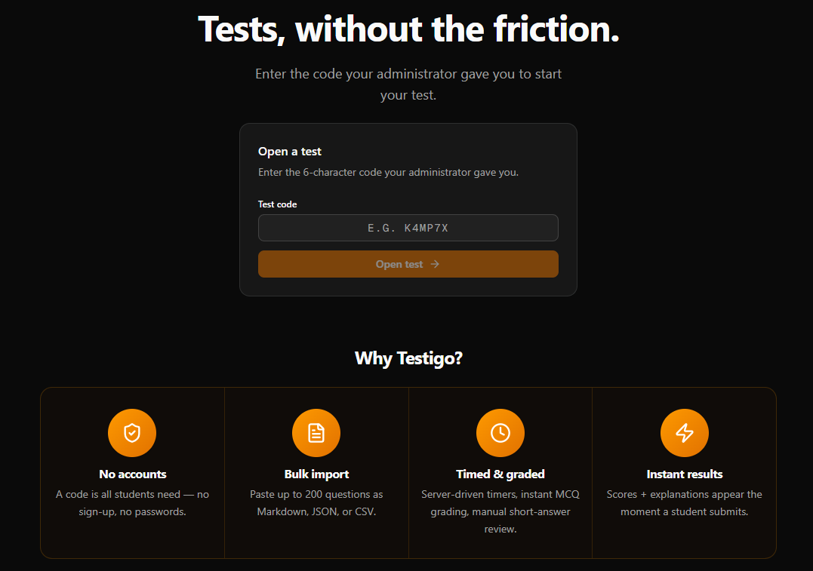
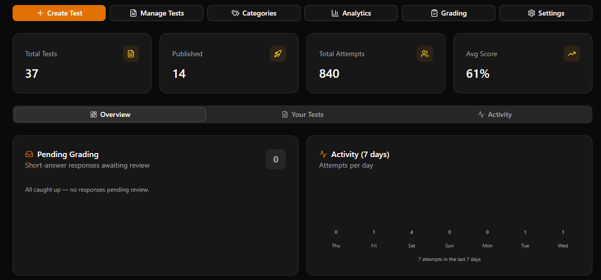
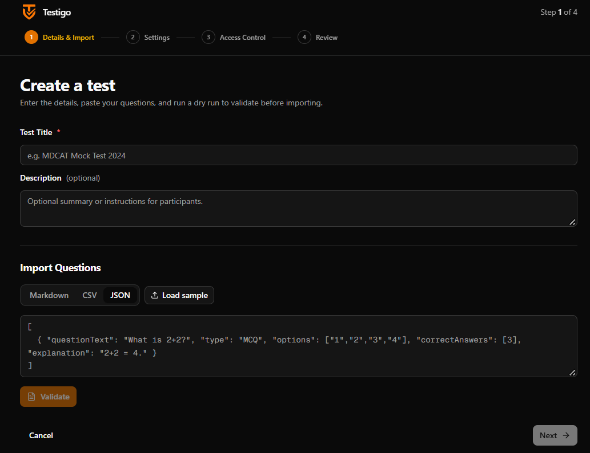
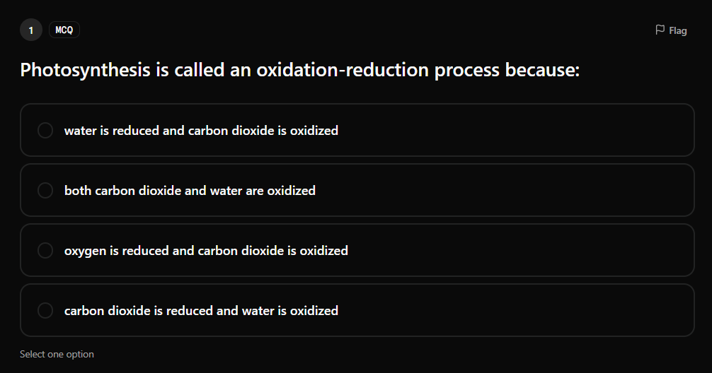
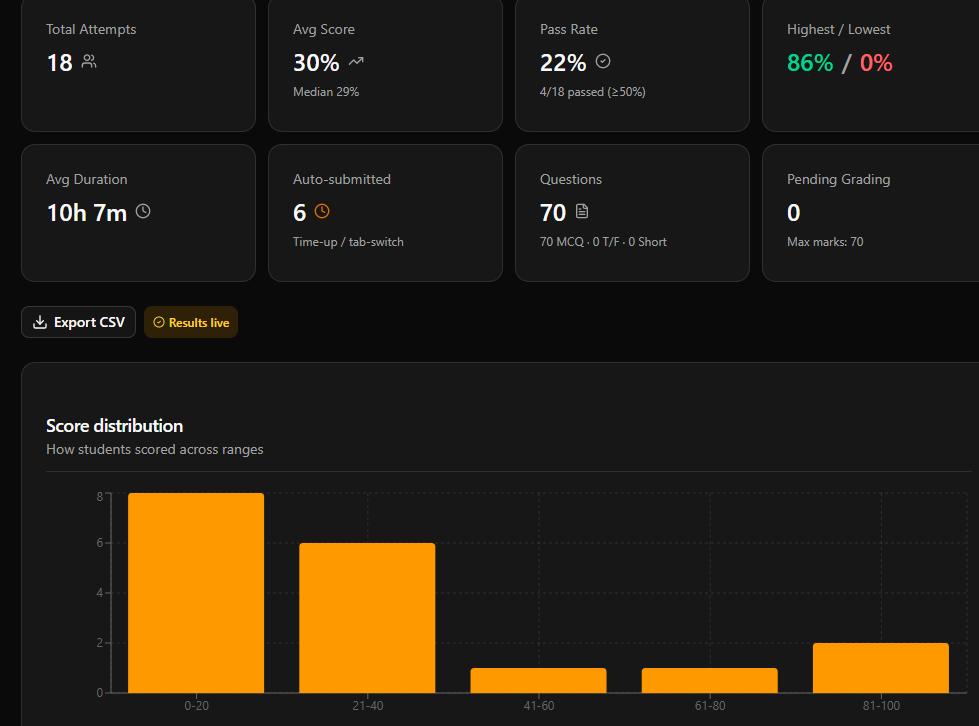
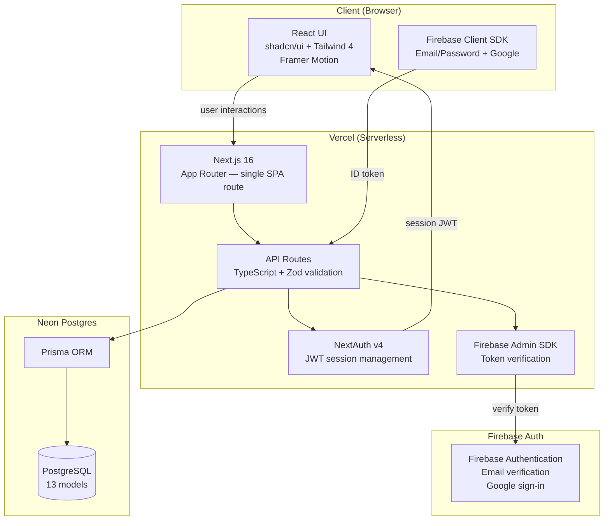
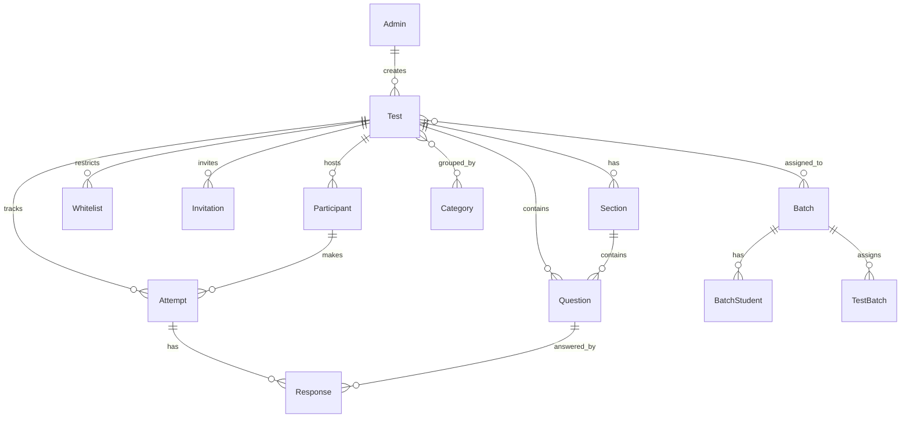

# Testigo

### A modern test & exam platform where students never need an account.

---

## Overview

Testigo is a secure, admin-driven platform for creating and running online tests, quizzes, and exams. It is built on a simple idea: **educators should have accounts, students should not.**

Students access tests through a short code or a direct link, take the test in a focused, distraction-free environment, receive instant auto-grading, and review their answers — all without ever creating an account, verifying an email, or remembering a password.

Built for tutors, coaching centers, schools, and anyone who needs to run assessments without the overhead and friction of a full LMS.

> **Note:** This is a showcase repository. The source code is private. This repo exists to showcase the project's features, architecture, and capabilities. The live demo is available at [testigo.site](https://testigo.site).

---

## Screenshots

> All screenshots are in dark mode.

### Home — Enter a test code

### Admin Dashboard — Overview with stats and activity

### Create a Test — Bulk import with live validation

### Take a Test — MCQ with timer and question palette

### Analytics — Score distribution and per-question difficulty

---

## Features

### For Students
- **No account, no friction** — access tests via a 6-character code or a direct link
- **Hardened test environment** — copy/paste, context menu, and text selection are disabled during the test
- **Tab-switch detection** — warns on distractions, auto-submits after repeated switches
- **Backend-driven timer** — the clock can't be cheated by changing the device time
- **Automatic saving** — answers are saved continuously, so a refresh or network hiccup never loses progress
- **Instant results** — scores, correct answers, and explanations appear immediately after submission
- **Responsive design** — works seamlessly on phones, tablets, and laptops
- **Section-wise tests** — tests can be divided into sections (e.g. English, Math, IQ) with sequential navigation and per-section timers

### For Educators
- **4-step test creation wizard** — details, settings, access control, review and publish
- **Bulk question import** — paste questions in CSV, JSON, or Markdown, with a live dry-run validator
- **Three question types** — multiple choice (single or multi-correct), true/false, and short answer
- **Test sections** — divide tests into sections with passages, multi-question pages, and sequential locking
- **Student batches** — create batches of students by Student ID, assign tests to batches, enforce attempt limits
- **Test categories** — organize tests by batch, subject, or any grouping
- **Three access modes**:
  - **Public** — anyone with the link
  - **Whitelist** — only registered phone numbers
  - **Invite** — single-use invitation links, one per student
- **Automatic grading** — MCQ and true/false graded instantly; short answers go into a manual grading queue
- **Rich analytics** — score distribution, per-question difficulty, pass rate, median, rank, duration analytics, skip rate
- **CSV export** — download all student results for offline analysis
- **Full editability** — change test settings, add, edit, or delete questions even after publishing
- **Result release modes** — immediate, manual (hold scores until release), or never

### Platform
- **Firebase Authentication** — email/password + Google sign-in with email verification
- **Approval workflow** — new registrations require email verification + admin approval before login
- **Admin trash** — rejected/deleted accounts are held for 7 days with restore option before permanent deletion
- **Platform tour** — interactive carousel showcasing the platform's capabilities

---

## Architecture

Database schema (13 models)

---

## Live Demo

The platform is live at **[testigo.site](https://testigo.site)**.

- **Students** can enter a test code (if they have one) or use a direct link
- **Admins** can sign in with their credentials
- **New admins** can request access via the registration page (requires email verification + approval)

---

## Platform Integrity

- **Firebase Authentication** with email verification before account activation
- **Admin approval workflow** — even after email verification, accounts need admin approval
- **Server-driven timer** — the backend records the start time; client clocks are never trusted
- **Correct answers never reach the student's browser** during a test
- **Copy/paste, context menu, and text selection disabled** during test-taking
- **Tab-switch monitoring** — warns twice, auto-submits on the third switch
- **Soft-delete with 7-day retention** — rejected/deleted accounts can be restored within 7 days
- **Object-level authorization** — every resource is ownership-checked

---

## Technology Stack

| Layer | Technology |
|-------|-----------|
| Framework | Next.js 16 (App Router) |
| Language | TypeScript 5 |
| Styling | Tailwind CSS 4 + shadcn/ui |
| Database | PostgreSQL (Neon) |
| ORM | Prisma 6 |
| Authentication | Firebase Auth + NextAuth v4 (JWT) |
| State | Zustand + fetch |
| Icons | Lucide |
| Charts | Recharts |
| Animations | Framer Motion |

---

## Use Cases

- **Schools and universities** — weekly quizzes, midterms, practice tests
- **Coaching and tutoring centers** — batch exams with Student ID verification
- **Corporate training** — compliance checks, onboarding assessments
- **Certification bodies** — high-stakes exams with single-use invite links
- **Community surveys** — quick public polls with instant results
- **Recruitment** — pre-interview screening tests

---

## Contributing

This is a personal project, but feedback and suggestions are welcome. Feel free to:

- Open an [issue](https://github.com/Qadyyr/Testigo-Showcase/issues) to report a bug or suggest a feature
- Start a [discussion](https://github.com/Qadyyr/Testigo-Showcase/discussions) to share ideas

---

## License

This is a personal project. The source code is private and not available for public use, modification, or distribution. The platform is showcased here for portfolio and demonstration purposes only.

See [LICENSE](LICENSE) for the full terms.

---

**[Live Demo](https://testigo.site)** · **[Report a Bug](https://github.com/Qadyyr/Testigo-Showcase/issues)** · **[Request a Feature](https://github.com/Qadyyr/Testigo-Showcase/issues)**

Built by [Qadyyr](https://github.com/Qadyyr) & Shadowolf Systems

